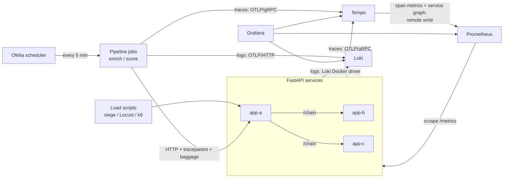

# FastAPI with Observability

Observe the FastAPI application with three pillars of observability on [Grafana](https://github.com/grafana/grafana):

1. Traces with [Tempo](https://github.com/grafana/tempo) and [OpenTelemetry Python SDK](https://github.com/open-telemetry/opentelemetry-python)
2. Metrics with [Prometheus](https://prometheus.io/) and [Prometheus Python Client](https://github.com/prometheus/client_python)
3. Logs with [Loki](https://github.com/grafana/loki)

This repository is a fork of [blueswen/fastapi-observability](https://github.com/blueswen/fastapi-observability) (MIT, © 2022 Blueswen; see [NOTICE](NOTICE)). The original project provides the three FastAPI services, their metrics, traces and log correlation, and the `FastAPI Observability` dashboard.

## What this fork adds

- **Observable batch jobs**: [scheduled CSV pipelines](#scheduled-csv-pipelines) whose runs and records are correlated across traces, logs and metrics, including the FastAPI services they call (W3C baggage carries `run_id` and `record_id`).
- **OTLP log ingestion**: job logs go straight to Loki's native OTLP endpoint, with correlation IDs as structured metadata.
- **Metrics derived from traces**: Tempo's metrics generator produces RED metrics and a service graph, so batch jobs get metrics without a `/metrics` endpoint and without unbounded label cardinality.
- **Alerting on batch jobs**: failed runs, no successful run, and jobs that silently stopped.
- **Scheduled Pipelines dashboard**: run outcomes, throughput, latency with exemplars, service map, run traces and errors.
- **Hardening**: sanitized baggage (no log injection), ERROR traces for aborted runs, non-retryable `4xx`, safe run IDs.
- **Engineering hygiene**: unit tests and CI for both Python projects, a [one-week dependency policy](#dependency-policy) with digest- and SHA-pinned images and actions, slim non-root images, and upgrades to Python 3.15, Grafana 13 and Tempo 3.

## Architecture



The original architecture diagram ([images/observability-arch.jpg](images/observability-arch.jpg)) shows only the FastAPI part.

## Table of contents
- [FastAPI with Observability](#fastapi-with-observability)
  - [What this fork adds](#what-this-fork-adds)
  - [Architecture](#architecture)
  - [Table of contents](#table-of-contents)
  - [Quick Start](#quick-start)
  - [Scheduled CSV Pipelines](#scheduled-csv-pipelines)
    - [Run on Demand](#run-on-demand)
    - [Deploy Changes](#deploy-changes)
    - [Target Selection](#target-selection)
    - [Pipeline Observability](#pipeline-observability)
    - [Alerts](#alerts)
  - [Explore with Grafana](#explore-with-grafana)
    - [Metrics to Traces](#metrics-to-traces)
    - [Traces to Logs](#traces-to-logs)
    - [Logs to Traces](#logs-to-traces)
  - [Detail](#detail)
    - [FastAPI Application](#fastapi-application)
      - [Traces and Logs](#traces-and-logs)
      - [Span Inject](#span-inject)
      - [Metrics](#metrics)
      - [OpenTelemetry Instrumentation](#opentelemetry-instrumentation)
    - [Prometheus - Metrics](#prometheus---metrics)
      - [Prometheus Config](#prometheus-config)
      - [Grafana Data Source](#grafana-data-source)
    - [Tempo - Traces](#tempo---traces)
      - [Metrics Generator](#metrics-generator)
      - [Grafana Data Source](#grafana-data-source-1)
    - [Loki - Logs](#loki---logs)
      - [Loki Docker Driver](#loki-docker-driver)
      - [Grafana Data Source](#grafana-data-source-2)
    - [Grafana](#grafana)
  - [Tests](#tests)
  - [Dependency Policy](#dependency-policy)
  - [Reference](#reference)

## Quick Start

1. Create the local Grafana credential file

    ```bash
    printf 'GRAFANA_ADMIN_PASSWORD=%s\n' "$(openssl rand -base64 32)" > .env
    ```

    This stack binds its published ports to `127.0.0.1`; it is intended for local development. Use a TLS-terminating, authenticated reverse proxy rather than exposing the services directly on a shared network.

2. Install [Loki Docker Driver](https://grafana.com/docs/loki/latest/send-data/docker-driver/)

    ```bash
    # Linux or macOS on ARM64 (including Apple Silicon)
    docker plugin install grafana/loki-docker-driver:3.7.9-arm64 --alias loki --grant-all-permissions

    # Linux or macOS on AMD64
    docker plugin install grafana/loki-docker-driver:3.7.9-amd64 --alias loki --grant-all-permissions
    ```

    On macOS, install and start [Docker Desktop](https://www.docker.com/products/docker-desktop/) first. Docker Desktop automatically selects `linux/arm64` images on Apple Silicon. On Linux, install Docker Engine with the Compose v2 plugin. No `platform` override is required.

3. Build the scheduled pipeline image and start all services with Docker Compose v2

    ```bash
    # Linux: let pipeline jobs write data/pipeline-output/ as your user (Docker Desktop: optional)
    export PIPELINE_UID="$(id -u)" PIPELINE_GID="$(id -g)"

    docker compose build pipelines
    docker compose up --build -d
    ```

    Run Compose from the repository root: the scheduler mounts job volumes via `${PWD}`.

    If you get the error message `Error response from daemon: error looking up logging plugin loki: plugin loki found but disabled`, please run the following command to enable the plugin:

    ```bash
    docker plugin enable loki
    ```

4. Send requests with [siege](https://linux.die.net/man/1/siege) and curl to the FastAPI app

    ```bash
    # macOS
    brew install siege

    # Debian/Ubuntu Linux
    sudo apt-get update && sudo apt-get install -y siege

    bash request-script.sh
    bash trace.sh
    ```

    Or you can use [Locust](https://locust.io/) to send requests:

    ```bash
    python3 -m pip install locust
    python3 -m locust -f locustfile.py --headless --users 10 --spawn-rate 1 -H http://localhost:8000
    ```

    Or you can send requests with [k6](https://k6.io/):

    ```bash
    # macOS
    brew install k6

    # Debian/Ubuntu Linux
    sudo snap install k6

    k6 run --vus 1 --duration 300s k6-script.js
    ```

5. Open Grafana at [http://localhost:3000/](http://localhost:3000/) and log in as `admin` with the password from `.env`. Two dashboards are provisioned:

    - `FastAPI Observability`: request rates, latency, errors and logs of the FastAPI services (from the original project, also published on [Grafana Dashboards](https://grafana.com/grafana/dashboards/16110)).
    - `Scheduled Pipelines`: see [Pipeline Observability](#pipeline-observability). The first scheduled runs start at the next full five minutes.

    

## Scheduled CSV Pipelines

The `pipelines/` project is a small batch application with two commands. `enrich` calls `/io_task` once per CSV row. `score` calls `/chain` once per row, which fans out to `app-b` and `app-c`. [Ofelia](https://github.com/mcuadros/ofelia) starts each command every five minutes (at second zero) in a fresh, short-lived container. Quick Start already builds the image and starts the scheduler.

- **Input**: committed CSVs in `pipelines/data/input/`. Each row needs a `record_id` that is unique within the file.
- **Output**: `data/pipeline-output/<pipeline>/<run_id>.csv` (ignored by Git). The file is written atomically and never overwritten. Each row records the run and record IDs, both versions, the target, timestamps, HTTP status, attempts, outcome and response or error.
- **Identity**: every execution gets a `run_id`. `run_id`, `record_id` and the pipeline version travel to FastAPI as W3C baggage. The FastAPI version comes back in the `X-App-Version` header. Both versions are read from the respective `pyproject.toml`.
- **Retries**: up to three attempts with capped exponential backoff. Transport errors, `5xx`, `408` and `429` are retried; other `4xx` responses fail immediately. A failed record does not stop the remaining rows.
- **Exit codes**: `0` success, `1` at least one record failed, `2` the run aborted (invalid input, existing output, unreachable or mis-versioned target).

### Run on Demand

```bash
docker compose --profile manual run --rm pipelines score \
  --input /app/data/input/score.csv \
  --output-dir /data/output \
  --run-id local-score-001

docker compose --profile manual run --rm pipelines --help
```

The `manual` profile keeps this one-shot service out of `docker compose up`. To run the code outside Docker, see [pipelines/README.md](pipelines/README.md).

### Deploy Changes

Ofelia starts a new container for every run, so rebuilding the image is enough to deploy pipeline code. The next run uses it; a run in progress finishes on the old image, and no other service restarts:

```bash
docker compose build pipelines
```

Changes to the Ofelia labels in `docker-compose.yaml` (schedule, job environment, mounts, image tag) only take effect after recreating the scheduler: `docker compose up -d --force-recreate scheduler`. For auditable rollouts, give each release an immutable image tag (`fastapi-obs/pipelines:1.1.0`) and point the job labels at it.

### Target Selection

Which FastAPI deployment a job calls is configuration in [`etc/pipelines/targets.toml`](etc/pipelines/targets.toml), mounted into every job. A target names a concrete URL and the FastAPI version expected there; aliases such as `latest` point to a target:

```toml
[targets.app-v1]
url = "http://app-a:8000"
expected_version = "0.1.0"

[aliases]
latest = "app-v1"
```

A job resolves its target (`--target`, default `latest` or `FASTAPI_TARGET`) once at startup and checks `X-App-Version` from `/health`. If the version differs, the run aborts. To move future runs to a new app version, deploy it as a new target and repoint `latest`: running jobs stay on the URL they resolved, and no restart is needed.

### Pipeline Observability

The jobs emit all three signals and correlate them with the FastAPI services:

| Signal | How it is produced | Where to look |
| --- | --- | --- |
| Traces | OTLP/gRPC to Tempo. One `pipeline.run` span per execution, one `pipeline.record` span per row, an HTTPX client span per request. W3C `traceparent` and `baggage` carry the trace, `run_id` and `record_id` into `app-a`, `app-b` and `app-c`. | TraceQL `{ name = "pipeline.run" && status = error }` or `{ span.pipeline.run_id = "local-score-001" }` |
| Logs | OTLP/HTTP directly to Loki (`/otlp/v1/logs`). Ofelia creates job containers itself, so they never pass through the Compose Loki logging driver. `run_id`, `record_id` and versions become Loki structured metadata. | `{service_name="pipelines-score"} \| run_id="local-score-001"`; FastAPI logs: `{service_name="app-b"} \|= "run_id=local-score-001"` |
| Metrics | Tempo's metrics generator turns spans into RED metrics (`traces_spanmetrics_*`) and a service graph (`traces_service_graph_*`), remote-written to Prometheus. | `sum by (service, status_code) (rate(traces_spanmetrics_calls_total{span_name="pipeline.record"}[5m]))` |

Run and record IDs are deliberately **not** Prometheus labels: they are unbounded, so they live in traces and logs, while metrics stay aggregated per pipeline and status. Exemplars on the span-metrics latency histogram link a slow percentile back to a concrete trace.

Failures are visible in every signal. An aborted run is an ERROR `pipeline.run` span with an `exception` event, plus an ERROR log containing the traceback. A failed record sets ERROR on its `pipeline.record` span, records one `pipeline.attempt_failed` event per attempt, and counts towards `pipeline.failed_records` on the run span.

The predefined **Scheduled Pipelines** dashboard shows run outcomes, record throughput and p95 latency (with exemplars), the service map (`pipelines-* → app-a → app-b / app-c`), recent run traces and pipeline warnings/errors.

Scheduled jobs write only warnings and errors to stderr (`PIPELINE_CONSOLE_LOG_LEVEL=WARNING`), because Ofelia copies job output into its own `scheduler` log stream; the full log goes to Loki over OTLP.

Ofelia requires Docker socket access to create its transient job containers. This is suitable for the local Compose demo; replace it with a platform scheduler such as ECS Scheduled Tasks, AWS Batch, or Kubernetes CronJobs in production.

### Alerts

Prometheus evaluates [`etc/prometheus/pipeline-alerts.yml`](etc/prometheus/pipeline-alerts.yml) on the span metrics:

| Alert | Fires when |
| --- | --- |
| `PipelineRunFailed` | A `pipeline.run` span ended with ERROR in the last 10 minutes (aborted run or failed records). |
| `PipelineNoSuccessfulRun` | A pipeline is still running but nothing succeeded in 15 minutes. |
| `PipelineRunsMissing` | No runs at all for 20 minutes (scheduler down, image missing). Tempo drops idle series after 15 minutes, so this checks for absence. |

Active alerts appear in Grafana under **Alerting → Alert rules** (data source-managed) and on Prometheus' `/alerts` page. No Alertmanager is configured, so nothing is sent.

## Explore with Grafana

Grafana provides a great solution, which could observe specific actions in service between traces, metrics, and logs through trace ID and exemplar.


Image Source: [Grafana](https://grafana.com/blog/2021/03/31/intro-to-exemplars-which-enable-grafana-tempos-distributed-tracing-at-massive-scale/)

### Metrics to Traces

Get Trace ID from an exemplar in metrics, then query in Tempo.

Query: `histogram_quantile(.99,sum(rate(fastapi_requests_duration_seconds_bucket{app_name="app-a", path!="/metrics"}[1m])) by(path, le))`


*Screenshot from the original project: the exemplar label `job=app-a` is now `job=fastapi`.*

### Traces to Logs

Get Trace ID and tags (here is `service.name`) defined in Tempo data source from span, then query with Loki.


*Screenshot from the original project, with the older log format. Logs are now selected by `service_name` (for example `{service_name="app-a"}`) instead of `compose_service`, so the same link also works for pipeline jobs.*

### Logs to Traces

Get Trace ID from log (regex defined in Loki data source), then query in Tempo.


*Screenshot from the original project, with the older log format. Logs are now selected by `service_name` (for example `{service_name="app-a"}`) instead of `compose_service`, so the same link also works for pipeline jobs.*

## Detail

### FastAPI Application

For a more complex scenario, we use three FastAPI applications with the same code in this demo. There is a cross-service action in `/chain` endpoint, which provides a good example of how to use OpenTelemetry SDK and how Grafana presents trace information.

#### Traces and Logs

We use [OpenTelemetry Python SDK](https://github.com/open-telemetry/opentelemetry-python) to send trace info with gRPC to Tempo. Each request span contains other child spans when using OpenTelemetry instrumentation. The reason is that instrumentation will catch each internal asgi interaction ([opentelemetry-python-contrib issue #831](https://github.com/open-telemetry/opentelemetry-python-contrib/issues/831#issuecomment-1005163018)). If you want to get rid of the internal spans, there is a [workaround](https://github.com/open-telemetry/opentelemetry-python-contrib/issues/831#issuecomment-1116225314) in the same issue #831 by using a new OpenTelemetry middleware with two overridden methods for span processing.

We use [OpenTelemetry Logging Instrumentation](https://opentelemetry-python-contrib.readthedocs.io/en/latest/instrumentation/logging/logging.html) to override the logger format with another format with trace id and span id.

```py
# fastapi_app/utils.py

def setting_otlp(app: ASGIApp, app_name: str, app_version: str, endpoint: str,
                 log_correlation: bool = True, insecure: bool = False) -> None:
    resource = Resource.create(attributes={
        "service.name": app_name,        # for Tempo to distinguish source
        "service.version": app_version,  # from pyproject.toml
    })

    tracer = TracerProvider(resource=resource)
    trace.set_tracer_provider(tracer)
    tracer.add_span_processor(BatchSpanProcessor(
        OTLPSpanExporter(endpoint=endpoint, insecure=insecure)))

    if log_correlation:
        # Adds run_id / record_id / pipeline_version from W3C baggage to every log record.
        install_correlation_log_fields(app_version)
        LoggingInstrumentor().instrument(set_logging_format=True, logging_format=LOG_FORMAT)

    FastAPIInstrumentor.instrument_app(
        app,
        tracer_provider=tracer,
        # Copies the same baggage values onto the server span as pipeline.* attributes.
        server_request_hook=enrich_span_with_correlation,
    )
    # CLIENT spans for outgoing calls feed Tempo's service graph.
    HTTPXClientInstrumentor().instrument(tracer_provider=tracer)
```

Baggage arrives from untrusted callers, so values are truncated to 128 characters and restricted to `[A-Za-z0-9._:-]` before they reach logs or spans; a crafted header cannot inject forged log lines.

The following image shows the span info sent to Tempo and queried on Grafana. Trace span info provided by `FastAPIInstrumentor` with trace ID (ef106bd57e5d8223a23ee9e3c93be73b), span id(b4fff543781f9beb), service name(app-a), custom attributes(service.name=app-a) and so on.


Log format with trace id and span id, which is overridden by `LoggingInstrumentor`

```txt
%(asctime)s %(levelname)s [%(name)s] [%(filename)s:%(lineno)d] [trace_id=%(otelTraceID)s span_id=%(otelSpanID)s resource.service.name=%(otelServiceName)s run_id=%(run_id)s record_id=%(record_id)s pipeline_version=%(pipeline_version)s app_version=%(app_version)s] - %(message)s
```

Fields without baggage (for example, requests from the load-test scripts) are logged as `-`.

#### Span Inject

For other services to continue the same trace, the outgoing request must carry the current context in its headers (W3C `traceparent`, plus `baggage`). The FastAPI instrumentation only handles incoming requests, so `/chain` calls `inject` explicitly:

```py
# fastapi_app/main.py (simplified)

from opentelemetry.propagate import inject

@app.get("/chain")
async def chain(request: Request):
    headers = {}
    inject(headers)  # adds traceparent and baggage
    client = request.app.state.http_client  # one shared httpx.AsyncClient
    await asyncio.gather(
        client.get("http://localhost:8000/", headers=headers),
        client.get(f"http://{TARGET_ONE_HOST}:8000/io_task", headers=headers),
        client.get(f"http://{TARGET_TWO_HOST}:8000/cpu_task", headers=headers),
    )
    return {"path": "/chain"}
```

HTTPX is also instrumented, so each outgoing request gets its own CLIENT span; Tempo's service graph needs these CLIENT/SERVER span pairs to draw edges such as `app-a → app-b`. The [HTTPX instrumentation](https://github.com/open-telemetry/opentelemetry-python-contrib/tree/main/instrumentation/opentelemetry-instrumentation-httpx) injects the context by itself, so on its own it would be enough; the explicit `inject` is kept to show the mechanism:

```py
import httpx
from opentelemetry.instrumentation.httpx import HTTPXClientInstrumentor

HTTPXClientInstrumentor().instrument()

@app.get("/chain")
async def chain(response: Response):
    async with httpx.AsyncClient() as client:
        await client.get(f"http://localhost:8000/")
    async with httpx.AsyncClient() as client:
        await client.get(f"http://{TARGET_ONE_HOST}:8000/io_task")
    async with httpx.AsyncClient() as client:
        await client.get(f"http://{TARGET_TWO_HOST}:8000/cpu_task")

    return {"path": "/chain"}
```

#### Metrics

Use [Prometheus Python Client](https://github.com/prometheus/client_python) to expose metrics in [OpenMetrics](https://prometheus.io/docs/specs/om/open_metrics_spec/) format with [exemplars](https://github.com/prometheus/client_python#exemplars) and expose on `/metrics` for Prometheus.

In order to add an exemplar to metrics, we retrieve the trace id from the current span for the exemplar and add the trace id dict to the Histogram or Counter metrics.

```py
# fastapi_app/utils.py

from opentelemetry import trace
from prometheus_client import Histogram

REQUESTS_PROCESSING_TIME = Histogram(
    "fastapi_requests_duration_seconds",
    "Histogram of requests processing time by path (in seconds)",
    ["method", "path", "app_name"],
)

# retrieve trace id for exemplar
span = trace.get_current_span()
trace_id = trace.format_trace_id(
      span.get_span_context().trace_id)

REQUESTS_PROCESSING_TIME.labels(method=method, path=path, app_name=self.app_name).observe(
      after_time - before_time, exemplar={'TraceID': trace_id}
)
```

Because exemplars is a new datatype proposed in [OpenMetrics](https://github.com/prometheus/OpenMetrics/blob/main/specification/OpenMetrics.md#exemplars), `/metrics` have to use `CONTENT_TYPE_LATEST` and `generate_latest` from `prometheus_client.openmetrics.exposition` module instead of `prometheus_client` module ([Prometheus Client Document](https://prometheus.github.io/client_python/instrumenting/exemplars/)). Otherwise using the wrong generate_latest the exemplars dict behind Counter and Histogram will never show up, and using the wrong CONTENT_TYPE_LATEST will cause Prometheus scraping to fail.

```py
# fastapi_app/utils.py

from prometheus_client import REGISTRY
from prometheus_client.openmetrics.exposition import CONTENT_TYPE_LATEST, generate_latest

def metrics(request: Request) -> Response:
    return Response(generate_latest(REGISTRY), headers={"Content-Type": CONTENT_TYPE_LATEST})
```

Metrics with exemplars


#### OpenTelemetry Instrumentation

There are two methods to add trace information to spans and logs using the OpenTelemetry Python SDK:

1. [Code-based Instrumentation](https://opentelemetry.io/docs/languages/python/instrumentation/): This involves adding trace information to spans, logs, and metrics using the OpenTelemetry Python SDK. It requires more coding effort but allows for the addition of exemplars to metrics. We employ this approach in this project.
2. [Zero-code Instrumentation](https://opentelemetry.io/docs/zero-code/python/): This method automatically instruments a Python application using instrumentation libraries, but only when the used [frameworks and libraries](https://github.com/open-telemetry/opentelemetry-python-contrib/tree/main/instrumentation#readme) are supported. It simplifies the process by eliminating the need for manual code changes. However, it does not allow for the addition of exemplars to metrics. For more insights into zero-code instrumentation, see the original author's [OpenTelemetry APM](https://github.com/blueswen/opentelemetry-apm?tab=readme-ov-file#python---fastapi).

### Prometheus - Metrics

Scrapes the FastAPI services, receives span metrics from Tempo over remote write (`--web.enable-remote-write-receiver`), stores exemplars (`--enable-feature=exemplar-storage`) and evaluates the [pipeline alert rules](#alerts).

#### Prometheus Config

One scrape job in `etc/prometheus/prometheus.yml` covers all FastAPI services; the `app_name` label on each metric tells them apart.

```yaml
...
scrape_configs:
  - job_name: 'fastapi'
    scrape_interval: 5s
    static_configs:
      - targets: ['app-a:8000', 'app-b:8000', 'app-c:8000']
```

#### Grafana Data Source

Add an Exemplars which uses the value of `TraceID` label to create a Tempo link.

Grafana data source setting example:


Grafana data sources config example:

```yaml
name: Prometheus
type: prometheus
typeName: Prometheus
access: proxy
url: http://prometheus:9090
password: ''
user: ''
database: ''
basicAuth: false
isDefault: true
jsonData:
  exemplarTraceIdDestinations:
    - datasourceUid: tempo
      name: TraceID
  httpMethod: POST
readOnly: false
editable: true
```

### Tempo - Traces

Receives spans from applications and pipeline jobs over OTLP/gRPC.

#### Metrics Generator

Tempo derives metrics from the spans it ingests and remote-writes them to Prometheus, which therefore runs with `--web.enable-remote-write-receiver`:

```yaml
# etc/tempo/tempo.yml
metrics_generator:
  storage:
    path: /var/tempo/generator/wal
    remote_write:
      - url: http://prometheus:9090/api/v1/write
        send_exemplars: true
overrides:
  defaults:
    metrics_generator:
      processors:
        - span-metrics    # traces_spanmetrics_calls_total, traces_spanmetrics_latency_bucket
        - service-graphs  # traces_service_graph_request_total -> Grafana service map
```

This gives RED metrics for every service, including batch jobs that expose no `/metrics` endpoint, without instrumenting them twice.

#### Grafana Data Source

[Trace to logs](https://grafana.com/docs/grafana/latest/datasources/tempo/#trace-to-logs) setting:

1. Data source: target log source
2. Tags: key of tags from the trace, which will be log query criteria if the key exists in the trace
   1. Without as value: use the key as query label
   2. With as value: convert the tag key to another key as query label

Grafana data sources config example:

```yaml
uid: tempo
orgId: 1
name: Tempo
type: tempo
typeName: Tempo
access: proxy
url: http://tempo:3200
password: ''
user: ''
database: ''
basicAuth: false
isDefault: false
jsonData:
  nodeGraph:
    enabled: true
  serviceMap:
    datasourceUid: prometheus
  tracesToLogsV2:
    customQuery: false
    datasourceUid: loki
    filterBySpanID: false
    filterByTraceID: true
    tags:
      - key: service.name
        value: service_name
  tracesToMetrics:  # span -> its request/error rate from span metrics
    datasourceUid: prometheus
readOnly: false
editable: true
```

### Loki - Logs

Collects logs from two sources that share the `service_name` label:

1. Long-running Compose services, through the Loki Docker Driver.
2. Scheduled pipeline jobs, through Loki's native OTLP endpoint (`http://loki:3100/otlp/v1/logs`). Loki maps the OpenTelemetry `service.name` resource attribute to `service_name` and stores log attributes such as `run_id` as structured metadata.

The Loki image (`etc/loki/Dockerfile`) is the official distroless `grafana/loki` image plus one static `busybox` binary, so the Compose healthcheck can call `busybox wget` on `/ready`. Tempo 3 needs no such addition: its healthcheck runs `/tempo -health`.

#### Loki Docker Driver

1. Use [YAML anchor and alias](https://support.atlassian.com/bitbucket-cloud/docs/yaml-anchors/) feature to set logging options for each service.
2. Set [Loki Docker Driver options](https://grafana.com/docs/loki/latest/clients/docker-driver/configuration/)
   1. loki-url: loki service endpoint
   2. loki-pipeline-stages: processes multiline log from FastAPI application with multiline and regex stages ([reference](https://grafana.com/docs/loki/latest/clients/promtail/stages/multiline/))
   3. loki-relabel-config: copies `compose_service` to `service_name`, so driver logs use the same label as OTLP logs and Tempo's trace-to-logs link works for every service

```yaml
x-logging: &default-logging # anchor(&): 'default-logging' for defines a chunk of configuration
  driver: loki
  options:
    loki-url: 'http://localhost:3100/api/prom/push'
    loki-pipeline-stages: |
      - multiline:
          firstline: '^\d{4}-\d{2}-\d{2} \d{1,2}:\d{2}:\d{2}'
          max_wait_time: 3s
      - regex:
          expression: '^(?P<time>\d{4}-\d{2}-\d{2} \d{1,2}:\d{2}:\d{2},\d{3}) (?P<message>(?s:.*))$$'
# Use $$ (double-dollar sign) when your configuration needs a literal dollar sign.

services:
   foo:
      image: foo
      logging: *default-logging # alias(*): refer to 'default-logging' chunk 
```

#### Grafana Data Source

Add a TraceID derived field to extract the trace id and create a Tempo link from the trace id.

Grafana data source setting example:


Grafana data source config example:

```yaml
name: Loki
type: loki
typeName: Loki
access: proxy
url: http://loki:3100
password: ''
user: ''
database: ''
basicAuth: false
isDefault: false
jsonData:
  derivedFields:
    - datasourceUid: tempo
      matcherRegex: (?:trace_id)=(\w+)
      matcherType: regex
      name: TraceID
      url: $${__value.raw}
      # Use $$ (double-dollar sign) when your configuration needs a literal dollar sign.
readOnly: false
editable: true
```

### Grafana

1. Add Prometheus, Tempo, and Loki to the data source with config file `etc/grafana/datasource.yml`.
2. Load predefined dashboards with `etc/dashboards.yaml`: `etc/dashboards/fastapi-observability.json` and `etc/dashboards/scheduled-pipelines.json`.

```yaml
# grafana in docker-compose.yaml
grafana:
   image: grafana/grafana:13.3.0@sha256:...
   volumes:
      - ./etc/grafana/:/etc/grafana/provisioning/datasources # data sources
      - ./etc/dashboards.yaml:/etc/grafana/provisioning/dashboards/dashboards.yaml # dashboard setting
      - ./etc/dashboards:/etc/grafana/dashboards # dashboard json files directory
```

## Tests

Requires [uv](https://docs.astral.sh/uv/getting-started/installation/); it installs the pinned Python version automatically.

```bash
(cd fastapi_app && uv run --locked pytest -q)
(cd pipelines && uv run --locked pytest -q)
```

The GitHub Actions `Tests` workflow runs both suites, validates `docker-compose.yaml` and builds the pipeline image on every pull request.

## Dependency Policy

Only dependency versions that have been public for **at least one week** are used. New releases occasionally turn out to be broken or compromised and are yanked within days; waiting a week avoids most of them.

| Dependencies | Enforcement |
| --- | --- |
| Python packages | `[tool.uv] exclude-newer = "1 week"` in `fastapi_app/pyproject.toml` and `pipelines/pyproject.toml`. uv ignores any artifact uploaded in the last week when resolving; `uv.lock` records the rule, and CI runs with `--locked`. |
| Container images | Pinned as `name:tag@sha256:digest` in `docker-compose.yaml` and the Dockerfiles. Official tags such as `python:3.15.2-slim-trixie` are re-pushed for OS patches, so only the digest fixes the exact artifact. |
| GitHub Actions | Pinned to full commit SHAs with the version in a comment; `setup-uv` installs a pinned uv version. |
| Updates | Dependabot (`.github/dependabot.yml`) proposes updates weekly for all four ecosystems with `cooldown: default-days: 7`. |

Update Python dependencies manually with:

```bash
(cd fastapi_app && uv lock --upgrade)
(cd pipelines && uv lock --upgrade)
```

## Reference

1. [FastAPI Traces Demo](https://github.com/softwarebloat/python-tracing-demo)
2. [Waber - A Uber-like (Car-Hailing APP) cloud-native application with OpenTelemetry](https://github.com/Johnny850807/Waber)
3. [Intro to exemplars, which enable Grafana Tempo’s distributed tracing at massive scale](https://grafana.com/blog/2021/03/31/intro-to-exemplars-which-enable-grafana-tempos-distributed-tracing-at-massive-scale/)
4. [Trace discovery in Grafana Tempo using Prometheus exemplars, Loki 2.0 queries, and more](https://grafana.com/blog/2020/11/09/trace-discovery-in-grafana-tempo-using-prometheus-exemplars-loki-2.0-queries-and-more/)
5. [The New Stack (TNS) observability app](https://github.com/grafana/tns)
6. [Don’t Repeat Yourself with Anchors, Aliases and Extensions in Docker Compose Files](https://medium.com/@kinghuang/docker-compose-anchors-aliases-extensions-a1e4105d70bd)
7. [How can I escape a $ dollar sign in a docker compose file?](https://stackoverflow.com/a/40621373)
8. [Tempo Trace to logs tags discussion](https://community.grafana.com/t/need-to-customize-tempo-option-for-trace-logs-with-loki/59612)
9. [Starlette Prometheus](https://github.com/perdy/starlette-prometheus)
10. [Tempo Example](https://github.com/grafana/tempo/tree/main/example/docker-compose/local)
